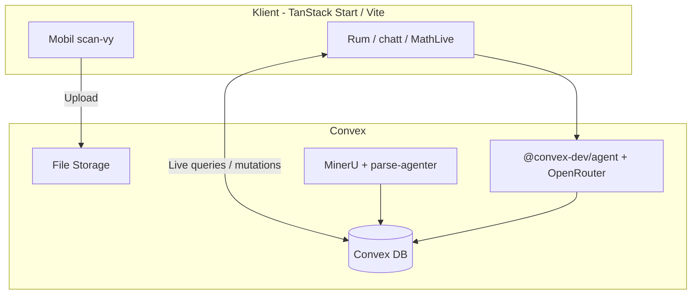

# Lumo

Sokratisk studieplattform för matematik/naturvetenskap/teknik. Studenter pluggar i **kursrum** med parsade uppgifter, AI-chatt (guidad hjälp, inte facit-maskin), QR-uppladdning från telefon, och delbara rumsmallar.

Detta dokument speglar **vad som faktiskt finns i kodbasen**. Äldre vision (SIWC, RAG, hjälpnivåer, luckformler, Tauri) är markerad som dropped / not planned / later — planera inte mot fiktion.

---

## Stack (nu)

| Lager | Teknik |
| --- | --- |
| Frontend | **TanStack Start** + **Vite** + React 19 + TanStack Router/Query |
| UI | Tailwind CSS 4, Base UI / shadcn-style components, MathLive |
| Backend | **Convex** (DB, file storage, auth hooks, crons, `@convex-dev/agent`) |
| AI | **OpenRouter** → `openai/gpt-4.1-mini` (**app-betald** API-nyckel, inte användarens ChatGPT-kvot) |
| PDF | MinerU-parse → problem/info-agenter → cachade `problems` (inte RAG/vektorsök) |

Kör lokalt: `npm run dev` (`convex dev --start 'vite dev'`).

---

## Vad som fungerar idag

1. **Kursrum** — skapa rum, medlemskap, filer (PDF m.m.), generalInfo till AI, radera rum.
2. **Mallar** — publicera rum som `roomTemplates`, sök/klona; expired-mallar med optional replacement.
3. **PDF-parse (inte RAG)** — MinerU middle_json + LLM extraherar uppgifter/facit, cachas per content-hash. AI får relevant problemtext inklippt i prompten; ingen embedding-/vectorSearch-pipeline.
4. **Uppgifter & tvillingar** — sidebar med grupperade problem; shadow/twin-uppgifter per rum.
5. **Chatt** — trådar per rum via `@convex-dev/agent`; lägen `normal` / `genomgang`; snabbval (quick replies); @-mention av uppgifter; MathLive i composer; arkivering / deletion expiry.
6. **QR → telefonkamera** — `scanSessions` + `/scan/$token` för att skicka bilder in i datorns flöde.
7. **Auth (temp)** — `@convex-dev/auth` med tillfällig credentials-provider. Riktig auth (Google m.m.) och SIWC är **senare / not planned** just nu.

Primär yta: startsida (`src/routes/index.tsx`) + rumsskal (`src/routes/rooms.$roomId.tsx`). Rumsskalet är **datororienterat** (se TODO nedan).

---

## Dropped / not planned / later

| Idé | Status | Kommentar |
| --- | --- | --- |
| **Hjälpnivå-reglage** (Hitta fel / Förklara / Lös helt) | **DROPPED** | Out of scope — not implemented; no UI or schema remnants. |
| **Luckformler / fill-in-the-blank** (MathLive `\placeholder`) | **DROPPED** | Implementeras inte. Interaktivitet går via chatt + quick replies, inte luckor. |
| **Sign in with ChatGPT (SIWC)** | Not planned (för nu) | Stubb/kommentar i `convex/auth.ts` + `authProviders/openai.ts`. AI körs via appens OpenRouter-nyckel. |
| **RAG / vector index** | Not planned | Parse + prompt-kontext räcker. Ingen `documentChunks`/embedding i live-schemat. |
| **Tauri / Electron desktop** | Future / not planned | Webbapp först. |
| **Riktig auth + städa demos** | Later | Temp-login + startsidans MathLive/PDF/CE-demos får vara kvar tills vidare. |
| **Mobil room layout** | Future TODO | QR-scan-sidan är mobil; själva rumsskalet är computer-only tills vidare. |
| **Splitta mega-komponenter + tunn convex-test** | Future TODO | Se TODOs nedan — ingen split/tester nu. |

---

## Arkitektur (förenklad)



Se `convex/schema.ts` för det verkliga schemat (rooms, files, roomTemplates, problems, roomThreads, scanSessions, mineruCache, …).

---

## Engineering TODOs (aktiv backlog)

Dessa speglas även som `// TODO:` i kod där det passar.

1. **Mobil room layout** — gör `rooms.$roomId` användbart på telefon (sidebar/main shell). Computer-only tills dess.
2. **Splitta mega-komponenter** — `chat-input.tsx`, `room-settings-panel.tsx`, `thread-chat.tsx` (och ev. rumssidan) i mindre delar.
3. **Tunn `convex-test`-svit** — några authz/happy-path-tester för kritiska Convex-funktioner; ingen stor suite ännu.

---

## Utveckling

```bash
npm install
npm run dev          # Convex + Vite
npm run typecheck
npm run lint
npm run build
```

Convex-env: bl.a. `OPENROUTER_API_KEY` (`npx convex env set …`).
