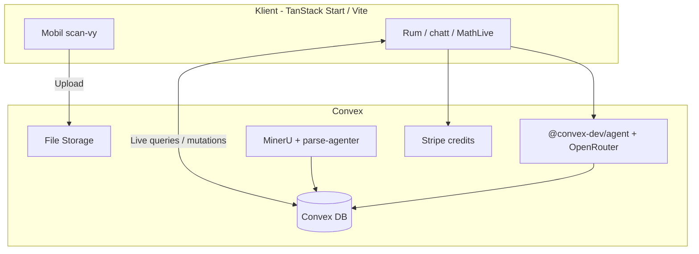

# Lumo

Sokratisk studieplattform för matematik/naturvetenskap/teknik. Studenter pluggar i **kursrum** med parsade uppgifter, AI-chatt (guidad hjälp, inte facit-maskin), QR-uppladdning från telefon, och delbara rumsmallar.

Detta dokument speglar **vad som faktiskt finns i kodbasen**. Äldre vision (RAG, hjälpnivåer, luckformler, Tauri) är markerad som dropped / not planned / later — planera inte mot fiktion.

---

## TODO
- privacy policy

## Stack (nu)

| Lager | Teknik |
| --- | --- |
| Frontend | **TanStack Start** + **Vite** + React 19 + TanStack Router/Query |
| UI | Tailwind CSS 4, Base UI / shadcn-style components, MathLive |
| Backend | **Convex** (DB, file storage, auth hooks, crons, `@convex-dev/agent`) |
| AI | **OpenRouter** → `openai/gpt-4.1-mini` (**app-betald** API-nyckel, inte användarens ChatGPT-kvot) |
| Billing | **Stripe** via `@convex-dev/stripe` (credit packs) |
| PDF | MinerU-parse → problem/info-agenter → cachade `problems` (inte RAG/vektorsök) |

Kör lokalt: `npm run dev` (`convex dev --start 'vite dev'`).

---

## Vad som fungerar idag

1. **Kursrum** — skapa rum, medlemskap, filer (PDF m.m.), generalInfo till AI, radera rum.
2. **Mallar** — publicera rum som `roomTemplates`, sök/klona; expired-mallar med optional replacement.
3. **PDF-parse (inte RAG)** — MinerU middle_json + LLM extraherar uppgifter/facit, cachas per content-hash. AI får relevant problemtext inklippt i prompten; ingen embedding-/vectorSearch-pipeline.
4. **PDF → studiemetoder** — info-agent destillerar rekommenderade metoder m.m. till `pdfInfo`; rum opt-in via `cellsInUseByRoom`.
5. **Uppgifter & tvillingar** — sidebar med grupperade problem; shadow/twin-uppgifter per rum (krediteras).
6. **Svårighet & klar-markering** — stjärnor 1–3 (`roomProblemStars`) och personlig completion (`roomProblemCompletions`).
7. **Chatt** — trådar per rum via `@convex-dev/agent`; lägen `normal` / `genomgang`; snabbval (quick replies); @-mention av uppgifter; MathLive i composer; arkivering / deletion expiry (problemchattar default `3h`).
8. **QR → telefonkamera** — `scanSessions` + `/scan/$token` för att skicka bilder in i datorns flöde.
9. **PDF-verktyg** — slå ihop / dela upp PDF:er (`/pdf` + dialoger i rummet); global cache via `pdfMerges` / `pdfExtracts`.
10. **Credits & billing** — dagliga gratiskrediter per roll, betalda top-ups via Stripe Checkout, spend på chatt/tvilling; profilsida med saldo.
11. **Roller** — `default` / `promoter` / `admin` (bl.a. freeDailyCredits); admin-UI på profilen.
12. **Auth (temp)** — `@convex-dev/auth` med tillfällig credentials-provider. SIWC / Google m.m. är later (se tabell).

Primär yta: marketing startsida (`src/routes/index.tsx`) + dashboard (`/dashboard`) + rumsskal (`src/routes/dashboard.rooms.$roomId.tsx`). Rumsskalet är **datororienterat** (se TODO nedan).

---

## Dropped / not planned / later

| Idé | Status | Kommentar |
| --- | --- | --- |
| **Hjälpnivå-reglage** (Hitta fel / Förklara / Lös helt) | **DROPPED** | Out of scope — not implemented; no UI or schema remnants. |
| **Luckformler / fill-in-the-blank** (MathLive `\placeholder`) | **DROPPED** | Implementeras inte. Interaktivitet går via chatt + quick replies, inte luckor. |
| **Sign in with ChatGPT (SIWC) + token usage** | Later | När OpenAI släpper SIWC med token usage: användarens ChatGPT-konto/kvot istället för (eller bredvid) app-betald OpenRouter. Stubb i `convex/auth.ts` + `authProviders/openai.ts`. |
| **RAG / vector index** | Not planned | Parse + prompt-kontext räcker. Ingen `documentChunks`/embedding i live-schemat. |
| **Tauri / Electron desktop** | Future / not planned | Webbapp först. |
| **Riktig auth (Google m.m.)** | Later | Temp-login tills vidare. |
| **Mobil room layout** | Future TODO | QR-scan-sidan är mobil; själva rumsskalet är computer-only tills vidare. |
| **Tunn convex-test** | Future TODO | Se TODOs nedan — ingen stor suite ännu. |

---

## Arkitektur (förenklad)



Se `convex/schema.ts` för det verkliga schemat (rooms, files, roomTemplates, problems, roomThreads, scanSessions, mineruCache, credits, …).

---

## Engineering TODOs (aktiv backlog)

Dessa speglas även som `// TODO:` i kod där det passar.

1. **Mobil room layout** — gör `dashboard/rooms/$roomId` användbart på telefon (sidebar/main shell). Computer-only tills dess.
2. **Tunn `convex-test`-svit** — några authz/happy-path-tester för kritiska Convex-funktioner; ingen stor suite ännu.

---

## Utveckling

```bash
npm install
npm run dev          # Convex + Vite
npm run typecheck
npm run lint
npm run build
```

Convex-env: bl.a. `OPENROUTER_API_KEY` (`npx convex env set …`). Stripe-nycklar behövs för credit checkout.

### PostHog

Produktanalytics (frontend + Convex) + AI Observability + Definitions-dashboards.

| Var | Värde |
| --- | --- |
| `.env.local` | `VITE_POSTHOG_PROJECT_TOKEN`, `VITE_POSTHOG_HOST` (t.ex. `https://eu.i.posthog.com`) |
| Convex | `POSTHOG_PROJECT_TOKEN` (**required**) + `POSTHOG_HOST` via `npx convex env set …` |
| Definitions CLI (`.env.local`) | `POSTHOG_PERSONAL_API_KEY` (`phx_…`), `POSTHOG_PROJECT_ID`; optional `POSTHOG_DEFINITIONS_HOST=https://eu.posthog.com` |

`posthog:apply` / `posthog:dry` laddar `.env.local` via `scripts/posthog-definitions.mjs`. Om `POSTHOG_HOST` är ingestion-URL (`*.i.posthog.com`) skrivs den om till app-host automatiskt.

`posthog:apply` kör också `posthog:fix-tiles` (workaround för [posthog-definitions#13](https://github.com/PostHog/posthog-definitions/issues/13) — insight-tiles droppas annars tyst).

`npm run deploy` kör `posthog:apply` efter Convex/build (innan Wrangler) — sätt Definitions-env till **lumo-prod** i den miljön. Lokalt synkar du **lumo-dev** med `npm run posthog:apply` / `posthog:dry`.
